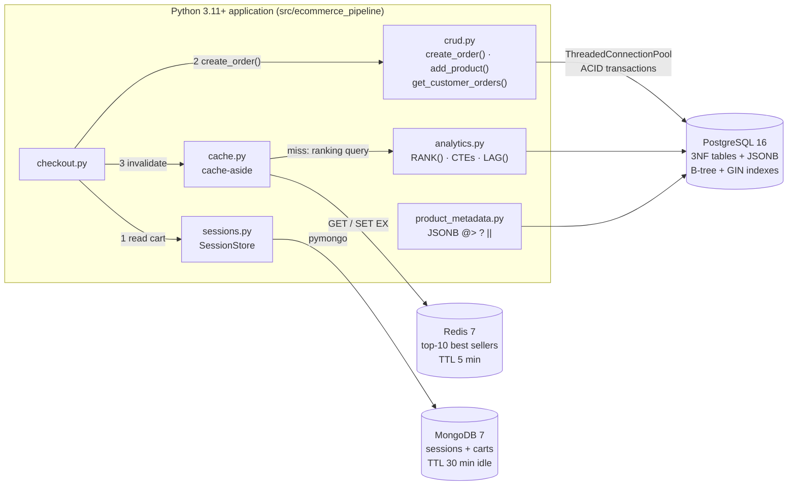
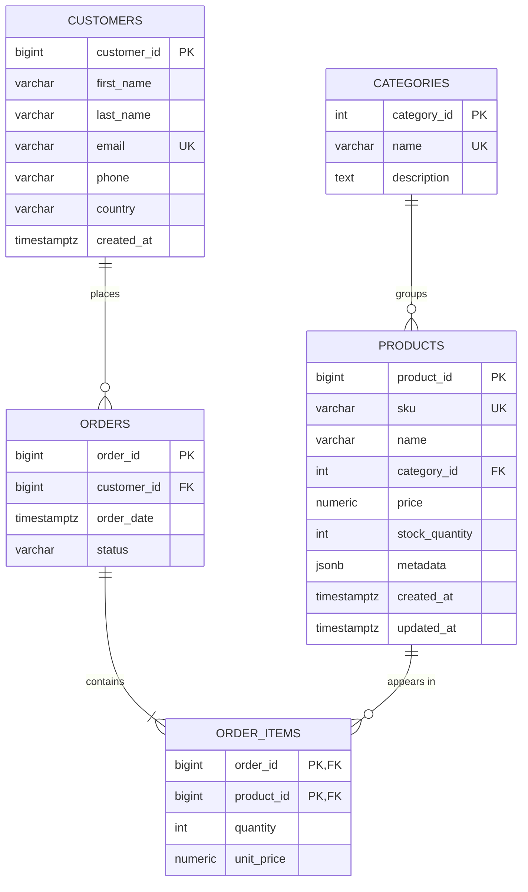

# E-Commerce Analytics Data Pipeline

[](https://github.com/Victoire67/E-Commerce-Analytics-Data-Pipeline/actions/workflows/ci.yml)

Data processing and analytics pipeline for a fictional e-commerce store, built on
PostgreSQL (3NF schema + JSONB), Redis (best-seller cache), and MongoDB (sessions/carts).

```bash
poetry install && cp .env.example .env && docker compose up -d
poetry run python scripts/run_demo.py      # runs everything end to end (seeds on first run)
```

## Contents

- [Architecture](#architecture) · [Prerequisites](#prerequisites) · [Setup](#setup) ·
  [Loading data](#loading-data)
- [Python API (CRUD)](#python-api-crud) · [SQL + NoSQL integration](#sql--nosql-integration) ·
  [Analytics queries](#analytics-queries)
- [Database design (ER diagram, 3NF)](#database-design) ·
  [Optimization report](#optimization-report) · [Development & testing](#development)
- [Requirements checklist](#requirements-checklist)

## Architecture



Each store holds the data it is best at:

| Data | Store | Why |
|---|---|---|
| Customers, products, orders, order items | **PostgreSQL** (3NF) | Money and stock need constraints, foreign keys and ACID transactions. This is the source of truth. |
| Product attributes (sizes, colors, specs…) | **PostgreSQL JSONB** | Attributes differ per category. JSONB keeps them flexible but still queryable, indexable (GIN) and transactional with the product row. |
| Top-10 best sellers | **Redis** | The ranking aggregates ~250k order lines (≈225 ms) but is read on every page. A cached copy answers in <1 ms, and losing it costs only one recomputation. |
| Sessions and carts | **MongoDB** | Short-lived, self-contained documents of varying shape, read/written whole on every request, expired automatically by a TTL index. They become relational data only at checkout. |

### Project structure

```
├── docker-compose.yml          PostgreSQL, Redis, MongoDB (healthchecks, named volumes)
├── pyproject.toml / poetry.lock / requirements.txt
├── .env.example                every setting, copied to .env
├── sql/
│   ├── 01_schema.sql           DDL: 3NF tables, PK/FK/UNIQUE/CHECK constraints
│   ├── 02_indexes.sql          B-tree on orders.customer_id, GIN on products.metadata
│   ├── 03_sample_data.sql      small hand-written dataset
│   └── analytics_queries.sql   window-function, CTE and JSONB queries for psql
├── src/ecommerce_pipeline/
│   ├── config.py               settings from .env
│   ├── db.py                   connection pool + transaction() context manager
│   ├── schema.py               create/drop tables and indexes from the SQL files
│   ├── crud.py                 customers, products, transactional orders
│   ├── product_metadata.py     JSONB queries and updates
│   ├── analytics.py            RANK(), CTEs, LAG()
│   ├── cache.py                Redis cache-aside for best sellers
│   ├── sessions.py             MongoDB sessions and carts
│   ├── checkout.py             MongoDB cart -> PostgreSQL order -> Redis invalidation
│   ├── seed.py                 bulk Faker data generator
│   └── benchmark.py            EXPLAIN ANALYZE before/after harness
├── scripts/                    check_connections, create_tables, seed_data, benchmark, run_demo
├── tests/                      68 pytest tests (real PostgreSQL, Redis, MongoDB)
├── docs/benchmark_results.md   full EXPLAIN ANALYZE plans
└── .github/workflows/ci.yml    lint + tests + smoke run on every push
```

## Prerequisites

- Python 3.11+
- [Poetry](https://python-poetry.org/) 2.x
- Docker Desktop (Docker Compose v2)

## Setup

```bash
# 1. Install Python dependencies into .venv/
poetry install

# 2. Create your local environment file and set real passwords
cp .env.example .env

# 3. Start PostgreSQL, Redis and MongoDB
docker compose up -d
docker compose ps        # wait until all three show "(healthy)"

# 4. Verify Python can reach all three services
poetry run python scripts/check_connections.py

# 5. Create tables, load data, and run the full demo
poetry run python scripts/create_tables.py
poetry run python scripts/seed_data.py
poetry run python scripts/run_demo.py
```

Without Poetry: `python -m venv .venv`, activate it, `pip install -r requirements.txt`, and
run the scripts with `PYTHONPATH=src`.

| Service    | Image              | Host port (default) | Used for                          |
|------------|--------------------|---------------------|-----------------------------------|
| PostgreSQL | `postgres:16-alpine` | 5432              | Customers, products, orders (3NF) |
| Redis      | `redis:7-alpine`   | 6379                | Top-10 best-seller cache          |
| MongoDB    | `mongo:7`          | 27017               | User sessions and carts           |

Useful commands: `docker compose logs <service>`, `docker compose down` (stop, keep data),
`docker compose down -v` (stop and delete all data).

## Loading data

```bash
poetry run python scripts/create_tables.py          # create schema (add --reset to recreate)
poetry run python scripts/seed_data.py              # 10k customers, 20k products, 100k orders
```

The seeder ([src/ecommerce_pipeline/seed.py](src/ecommerce_pipeline/seed.py)) uses Faker with a
fixed seed, so every run produces the same dataset. Rows are bulk-inserted with
`execute_values` in batches of 5,000 (~30 s for the full dataset). Popularity is skewed so a few
customers and products dominate, like real store data, and `metadata` differs per category
(sizes/colors/material for clothing, brand/warranty/specs for electronics, author/pages for books).
The large volume is deliberate: on a few hundred rows PostgreSQL always uses a sequential scan, so
index improvements are only measurable at scale.

For a small, readable dataset instead, load the hand-written SQL file:

```bash
docker exec -i ecommerce-postgres psql -U ecommerce_user -d ecommerce < sql/03_sample_data.sql
```

## Python API (CRUD)

All database access goes through a `ThreadedConnectionPool`
([db.py](src/ecommerce_pipeline/db.py)); `transaction()` commits on success and rolls back on any
exception. Every query in [crud.py](src/ecommerce_pipeline/crud.py) is parameterized (`%s`), so
input is never interpolated into SQL.

```python
from ecommerce_pipeline import crud

customer_id = crud.create_customer("Amina", "Uwase", "amina@example.com", country="Rwanda")
shirt = crud.add_product("CLO-1", "T-Shirt", "Clothing", 19.99, stock_quantity=10,
                         metadata={"colors": ["red"], "sizes": ["M", "L"]})
order_id = crud.create_order(customer_id, [(shirt, 2)])
crud.get_customer_orders(customer_id)   # orders with line items and computed totals
```

`create_order()` is a single ACID transaction: it locks the product rows
(`SELECT ... FOR UPDATE`, in a fixed order to avoid deadlocks), checks the customer, products and
stock, inserts the order and its lines at the current price, and decrements stock. Any failure
(`InsufficientStockError`, `ProductNotFoundError`, `CustomerNotFoundError`) rolls back everything,
so partial orders and overselling are impossible.

## SQL + NoSQL integration

### PostgreSQL JSONB: product metadata

[product_metadata.py](src/ecommerce_pipeline/product_metadata.py)

```python
from ecommerce_pipeline import product_metadata as pm

pm.find_products_by_metadata({"colors": ["red"], "sizes": ["XS"], "material": "leather"})  # @>
pm.find_products_by_metadata({"specs": {"wireless": True}})       # nested containment
pm.find_products_with_any_key(["warranty_months", "sizes"])       # ?|
pm.count_products_by_attribute("brand")                           # ->> + GROUP BY
pm.available_colors()                                             # jsonb_array_elements_text
pm.merge_product_metadata(42, {"limited_edition": True})          # metadata || patch
pm.remove_metadata_key(42, "limited_edition")                     # metadata - key
```

The containment and key operators are served by the GIN index (see the
[optimization report](#optimization-report)).

### Redis: top-10 best sellers (cache-aside)

[cache.py](src/ecommerce_pipeline/cache.py)

```python
from ecommerce_pipeline import cache

client = cache.get_redis()
result = cache.get_top_products(client)   # MISS: runs the RANK() query, SET key EX 300
result = cache.get_top_products(client)   # HIT: served from Redis
result.from_cache, result.products
cache.invalidate_top_products(client)     # after new orders
```

- **Key:** `ecommerce:top_products:10`, holding a JSON array. Decimals are stored as strings so
  money stays exact.
- **Expiry:** set atomically with `SET ... EX`. The default TTL is 300 s, so even without
  invalidation, stale data lives at most 5 minutes.
- **Invalidation:** checkout calls `invalidate_top_products()` after the order commits. The next
  read rebuilds the list.
- **Measured in the demo:** a miss (PostgreSQL aggregation over ~250k lines) takes ~225 ms; a
  hit takes ~1 ms.

### MongoDB: sessions and carts

[sessions.py](src/ecommerce_pipeline/sessions.py)

```json
{
  "_id": "724f6d43fa294f7e82c808f3953280d2",
  "customer_id": 10001,
  "created_at": "2026-11-01T10:00:00Z",
  "last_active": "2026-11-01T10:04:12Z",
  "device": {"os": "android", "app": "1.4.2"},
  "cart": [{"product_id": 1, "quantity": 2, "added_at": "2026-11-01T10:01:30Z"}]
}
```

```python
from ecommerce_pipeline.sessions import SessionStore

store = SessionStore.from_settings()            # also creates the indexes
sid = store.create_session(device={"os": "ios"})
store.add_to_cart(sid, product_id=7, quantity=2)  # same product again -> quantity += n
store.attach_customer(sid, customer_id=42)       # login keeps the cart
store.most_carted_products()                     # aggregation pipeline
```

- **TTL index** on `last_active` (30 min). MongoDB deletes abandoned sessions by itself. Every
  cart change refreshes `last_active`.
- **Atomic cart updates:** a positional `$inc` on `cart.$.quantity` merges lines, and
  `$push`/`$pull` add or remove them. The whole document is never rewritten.

### Checkout: where the three stores meet

[checkout.py](src/ecommerce_pipeline/checkout.py)

`checkout(store, redis_client, session_id)` reads the MongoDB cart, calls `create_order()` (the
PostgreSQL ACID transaction is the commit point), then clears the cart and invalidates the
Redis cache. If the order fails, for example because stock is insufficient, nothing is written
anywhere and the cart is kept so the customer can retry.

## Analytics queries

[analytics.py](src/ecommerce_pipeline/analytics.py), also runnable in psql from
[sql/analytics_queries.sql](sql/analytics_queries.sql). Cancelled orders are excluded.

| Function | Technique | Answers |
|---|---|---|
| `top_selling_products(10)` | CTE + `RANK() OVER (ORDER BY units_sold DESC)` | Best sellers (the list cached in Redis). Ties share a rank: 1, 2, 2, 4. |
| `product_rank_by_category(3)` | `RANK() OVER (PARTITION BY category …)` in a CTE, `SUM() OVER` for share | Top products *within* each category and their % of category revenue |
| `revenue_per_customer(10)` | Chained CTEs: order totals → customer totals → `RANK()` | Highest-value customers, order count, average order value |
| `monthly_revenue()` | CTE + `LAG()` + running `SUM() OVER` | Month-over-month growth and cumulative revenue |

The window rank is filtered in an outer query (`WHERE category_rank <= 3`) because window
functions are evaluated after `WHERE`. `RANK` was chosen over `ROW_NUMBER` so equal sellers
aren't arbitrarily split, and over `DENSE_RANK` so a rank still reflects how many items come
before it.

## Database Design

### ER diagram



Create the tables with `poetry run python scripts/create_tables.py` (add `--reset` to drop and
recreate). The DDL lives in [sql/01_schema.sql](sql/01_schema.sql).

### Normalization decisions (3NF)

| Rule | How the schema satisfies it |
|------|-----------------------------|
| **1NF** — atomic values, no repeating groups | An order's products are rows in `order_items`, not a list column on `orders`. |
| **2NF** — no partial dependency on a composite key | `order_items` has key `(order_id, product_id)`; `quantity` and `unit_price` depend on both. Product name/category depend only on `product_id`, so they stay in `products`. |
| **3NF** — no transitive dependencies | Category name/description depend on the category, not the product, so they live in `categories`. Customer details live only in `customers`; `orders` references them by `customer_id`. |

Deliberate choices:

- **`order_items.unit_price` is not duplication.** It records the price *when the order was
  placed*; `products.price` is the current price. Without it, a price change would rewrite
  historical revenue.
- **Order totals are not stored.** A total is `SUM(quantity * unit_price)` over the order's
  lines; storing it would create a value that can drift out of sync.
- **`products.metadata` is JSONB.** Attributes differ per category (sizes/colors for clothing,
  specs/warranty for electronics). Modelling each as a column would leave most columns NULL;
  an EAV table would make every read a pivot. JSONB keeps them queryable (and GIN-indexable)
  while the core, always-present fields stay relational.

### Constraints

- Identity primary keys on every table; composite PK on `order_items`.
- Foreign keys: `ON DELETE RESTRICT` for customers/products/categories (history can't be
  orphaned); `ON DELETE CASCADE` from `orders` to `order_items` (lines belong to their order).
- `UNIQUE` on `customers.email`, `products.sku`, `categories.name`.
- `CHECK`: price/unit_price ≥ 0, stock ≥ 0, quantity > 0, order status in a fixed set,
  basic email shape, metadata must be a JSON object.

## Optimization report

Indexes live in [sql/02_indexes.sql](sql/02_indexes.sql), separate from the schema, so their
effect can be measured. [scripts/benchmark.py](scripts/benchmark.py) drops them, runs each
query with `EXPLAIN (ANALYZE, BUFFERS)` (one warm-up run, then the median of 7), applies the
indexes, and measures again. Full before/after plans: [docs/benchmark_results.md](docs/benchmark_results.md).

```bash
poetry run python scripts/benchmark.py
```

**Dataset:** 10,000 customers · 20,000 products · 100,000 orders · 250,433 order items
(PostgreSQL 16 in Docker, warm cache). Customer 5000 has 10 orders.

| Query | Before | After | Speedup | Pages read |
|---|---|---|---:|---:|
| Orders of one customer (`WHERE customer_id = $1`) | Seq Scan · 4.505 ms | Bitmap Index Scan on `idx_orders_customer_id` · 0.062 ms | **72.7×** | 812 → 12 |
| `get_customer_orders()` (orders ⨝ items ⨝ products) | Seq Scan on orders · 4.383 ms | Bitmap Index Scan on `idx_orders_customer_id` · 0.178 ms | **24.6×** | 924 → 124 |
| `metadata @> '{"brand":"Voltix","warranty_months":36}'` (128 rows) | Seq Scan · 3.795 ms | Bitmap Index Scan on `idx_products_metadata_gin` · 0.446 ms | **8.5×** | 488 → 134 |
| `metadata @> '{"colors":["red"],"sizes":["XS"],"material":"leather"}'` (94 rows) | Seq Scan · 4.074 ms | Bitmap Index Scan on GIN · 0.531 ms | **7.7×** | 488 → 112 |
| `metadata ? 'warranty_months'` (3,338 rows, ~17%) | Seq Scan · 2.558 ms | Bitmap Index Scan on GIN · 1.354 ms | 1.9× | 488 → 492 |

Index sizes: `idx_orders_customer_id` 920 kB, `idx_products_metadata_gin` 688 kB.

### Reading the plans

**B-tree on `orders.customer_id`.** Before the index, the plan for "orders of customer 5000"
is a `Seq Scan` that reads all 812 pages of `orders` and throws away 99,990 of 100,000 rows
(`Rows Removed by Filter: 99990`) to keep 10. PostgreSQL indexes primary keys and UNIQUE
columns automatically, but **not foreign keys**, so this lookup (the core of
`get_customer_orders()`) was a full scan. With the B-tree, a `Bitmap Index Scan` finds the 10
row locations by walking the tree (2 index pages), then the `Bitmap Heap Scan` reads only the 10
table pages that hold them. 812 pages became 12 and time dropped 73×. The join query improves
less (25×) because its remaining cost is the 25 order-item and product lookups, which already
used primary-key indexes. A sequential scan's cost grows with the size of the table; an index
lookup's cost grows with the number of matching rows, so the gap widens as `orders` grows.

**GIN on `products.metadata`.** A B-tree can't search inside a JSON document. A GIN index
stores every key and value of every document and maps each to the rows that contain it, so
`@>` finds the posting lists for `"brand":"Voltix"` and `"warranty_months":36` and intersects
them. Selective containment queries (≈0.5% of products) go from reading all 488 pages to about
120: **~8× faster**.

**When an index doesn't help much.** `metadata ? 'warranty_months'` matches 17% of products.
The index still finds them, but the heap scan then visits almost every page anyway (488 → 492),
so the gain is small (1.9×). If the filter matched most of the table, the planner would rightly
keep the sequential scan. Indexes pay off for *selective* predicates.

### Trade-offs and decisions

- **Write cost.** Each index must be updated on every `INSERT`/`UPDATE` of its column. GIN is
  the most expensive to maintain, which is acceptable for a product catalogue (read-heavy, rarely
  written). Both indexes add 1.6 MB in total.
- **`jsonb_ops` vs `jsonb_path_ops`.** `jsonb_path_ops` builds a smaller, faster index but
  only supports `@>`. The default `jsonb_ops` was kept because the API also uses the key
  operators `?` and `?|`.
- **`ANALYZE` after indexing and seeding** refreshes the planner's statistics. Without fresh
  statistics the planner can misjudge how many rows match and pick the wrong plan.
- **Measured, not assumed.** Timings are medians of repeated runs on a warm cache, and the
  page counts (`BUFFERS`) are included because they don't depend on cache state.
- **Further candidates** (not needed by the current queries): `orders(order_date)` for monthly
  reports over a date range, and `order_items(product_id)` for "who bought product X" lookups.

## Development

```bash
poetry run pytest --cov=ecommerce_pipeline   # 68 tests, 99% coverage (needs docker compose up -d)
poetry run ruff check . && poetry run ruff format --check .
```

Tests use the real services, each isolated from your data: the `ecommerce_test` PostgreSQL
database (created automatically, rebuilt once per session, truncated before each test), Redis
DB 15 (flushed per test), and the `ecommerce_sessions_test` MongoDB database. If a service is
down, its tests are skipped with a message instead of failing.

| Test file | Covers |
|---|---|
| `test_crud.py` | CRUD, UNIQUE/CHECK violations, JSONB round-trip, SQL-injection payload stored verbatim |
| `test_orders.py` | Order totals, price at purchase, full rollback on bad stock/product/customer, 5 concurrent buyers vs 3 units (no overselling) |
| `test_product_metadata.py` | `@>` (arrays, nested), `?|`, `->>` grouping, array unnesting, `||` merge, `-` removal |
| `test_cache.py` | Miss → hit, ranking order, TTL, per-limit keys, stale-until-invalidated, cancelled orders ignored |
| `test_sessions.py` | Session/cart CRUD, quantity merge, TTL index, aggregation, checkout success/failure across all three stores |
| `test_analytics.py` | RANK ties, per-category ranks and shares, revenue per customer, LAG growth, running total; hand-computed expected values |
| `test_benchmark.py` | Index create/drop idempotency, GIN usable for `@>`, EXPLAIN harness and report |
| `test_seed.py`, `test_infrastructure.py` | Seed volumes/integrity/determinism, settings, URL-encoding, pool reuse, rollback |

GitHub Actions ([ci.yml](.github/workflows/ci.yml)) runs lint, the full test suite with
coverage, and an end-to-end smoke run (create tables → seed → benchmark) against PostgreSQL,
Redis and MongoDB service containers on every push.

`requirements.txt` is generated from the lock file for non-Poetry users:

```bash
poetry export -f requirements.txt --without-hashes -o requirements.txt
```

## Requirements checklist

| Lab requirement | Where |
|---|---|
| ER diagram; customers, products, orders, order_items | [ER diagram](#er-diagram) |
| `CREATE TABLE` scripts in 3NF with PK/FK/constraints; normalization documented | [sql/01_schema.sql](sql/01_schema.sql), [Normalization decisions](#normalization-decisions-3nf) |
| PostgreSQL in Docker; tables created by a Python script | [docker-compose.yml](docker-compose.yml), [scripts/create_tables.py](scripts/create_tables.py) |
| `psycopg2` with connection pooling | [db.py](src/ecommerce_pipeline/db.py) (`ThreadedConnectionPool`) |
| `create_order()`, `add_product()`, `get_customer_orders()` | [crud.py](src/ecommerce_pipeline/crud.py) |
| Parameterized queries (no SQL injection) | All modules use `%s` / `sql.Identifier`; tested in `test_crud.py`, `test_product_metadata.py` |
| Transactions for order creation (ACID) | `create_order()` + `transaction()`; tested in `test_orders.py` |
| JSONB product metadata | [product_metadata.py](src/ecommerce_pipeline/product_metadata.py) |
| Redis cache of top-10 best sellers | [cache.py](src/ecommerce_pipeline/cache.py) |
| MongoDB sessions/carts with `pymongo` | [sessions.py](src/ecommerce_pipeline/sessions.py), [checkout.py](src/ecommerce_pipeline/checkout.py) |
| Window functions (`RANK()`) | `top_selling_products()`, `product_rank_by_category()` |
| CTEs for revenue per customer | `revenue_per_customer()` |
| `EXPLAIN ANALYZE` inspection | [benchmark.py](src/ecommerce_pipeline/benchmark.py), [docs/benchmark_results.md](docs/benchmark_results.md) |
| B-tree index on `customer_id` with measured improvement | [sql/02_indexes.sql](sql/02_indexes.sql): 4.5 ms → 0.06 ms (73×) |
| GIN index on JSONB, efficient metadata queries | [sql/02_indexes.sql](sql/02_indexes.sql): ~4 ms → ~0.5 ms (8×) |
| SQL files (DDL + sample data) | [sql/](sql/) |
| `requirements.txt`, Python 3.11+ | [requirements.txt](requirements.txt), `requires-python = ">=3.11"` |
