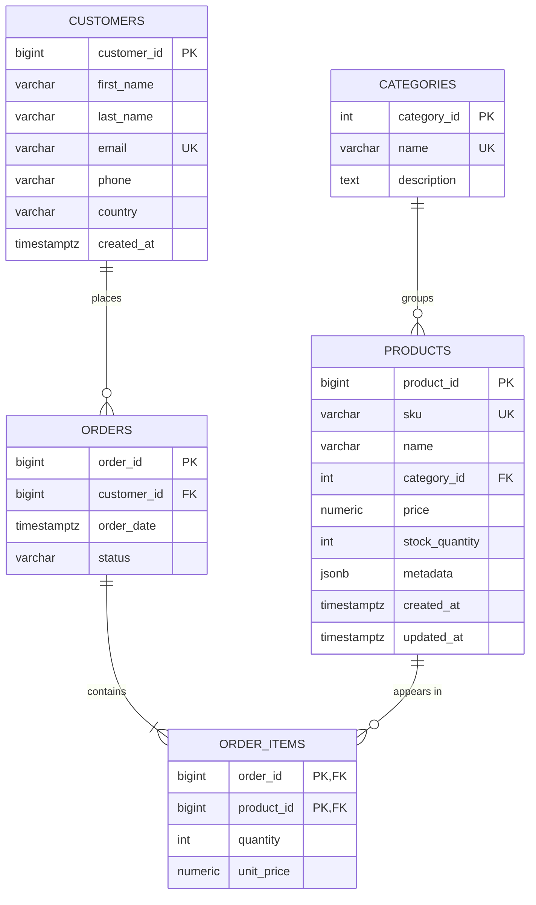

# E-Commerce Analytics Data Pipeline

Data processing and analytics pipeline for a fictional e-commerce store, built on
PostgreSQL (3NF schema + JSONB), Redis (best-seller cache), and MongoDB (sessions/carts).

## Prerequisites

- Python 3.11+
- [Poetry](https://python-poetry.org/) 2.x
- Docker Desktop (Docker Compose v2)

## Setup

```bash
# 1. Install Python dependencies into .venv/
poetry install

# 2. Create your local environment file and set real passwords
cp .env.example .env

# 3. Start PostgreSQL, Redis and MongoDB
docker compose up -d
docker compose ps        # wait until all three show "(healthy)"

# 4. Verify Python can reach all three services
poetry run python scripts/check_connections.py
```

| Service    | Image              | Host port (default) | Used for                          |
|------------|--------------------|---------------------|-----------------------------------|
| PostgreSQL | `postgres:16-alpine` | 5432              | Customers, products, orders (3NF) |
| Redis      | `redis:7-alpine`   | 6379                | Top-10 best-seller cache          |
| MongoDB    | `mongo:7`          | 27017               | User sessions and carts           |

Useful commands: `docker compose logs <service>`, `docker compose down` (stop, keep data),
`docker compose down -v` (stop and delete all data).

## Loading data

```bash
poetry run python scripts/create_tables.py          # create schema (add --reset to recreate)
poetry run python scripts/seed_data.py              # 10k customers, 20k products, 100k orders
```

The seeder ([src/ecommerce_pipeline/seed.py](src/ecommerce_pipeline/seed.py)) uses Faker with a
fixed seed, so every run produces the same dataset. Rows are bulk-inserted with
`execute_values` in batches of 5,000 (~30 s for the full dataset). Popularity is skewed so a few
customers and products dominate, like real store data, and `metadata` differs per category
(sizes/colors/material for clothing, brand/warranty/specs for electronics, author/pages for books).
The large volume is deliberate: on a few hundred rows PostgreSQL always uses a sequential scan, so
index improvements are only measurable at scale.

For a small, readable dataset instead, load the hand-written SQL file:

```bash
docker exec -i ecommerce-postgres psql -U ecommerce_user -d ecommerce < sql/03_sample_data.sql
```

## Python API (CRUD)

All database access goes through a `ThreadedConnectionPool`
([db.py](src/ecommerce_pipeline/db.py)); `transaction()` commits on success and rolls back on any
exception. Every query in [crud.py](src/ecommerce_pipeline/crud.py) is parameterized (`%s`), so
input is never interpolated into SQL.

```python
from ecommerce_pipeline import crud

customer_id = crud.create_customer("Amina", "Uwase", "amina@example.com", country="Rwanda")
shirt = crud.add_product("CLO-1", "T-Shirt", "Clothing", 19.99, stock_quantity=10,
                         metadata={"colors": ["red"], "sizes": ["M", "L"]})
order_id = crud.create_order(customer_id, [(shirt, 2)])
crud.get_customer_orders(customer_id)   # orders with line items and computed totals
```

`create_order()` is a single ACID transaction: it locks the product rows
(`SELECT ... FOR UPDATE`, in a fixed order to avoid deadlocks), checks the customer, products and
stock, inserts the order and its lines at the current price, and decrements stock. Any failure
(`InsufficientStockError`, `ProductNotFoundError`, `CustomerNotFoundError`) rolls back everything,
so partial orders and overselling are impossible.

## Database Design

### ER diagram



Create the tables with `poetry run python scripts/create_tables.py` (add `--reset` to drop and
recreate). The DDL lives in [sql/01_schema.sql](sql/01_schema.sql).

### Normalization decisions (3NF)

| Rule | How the schema satisfies it |
|------|-----------------------------|
| **1NF** — atomic values, no repeating groups | An order's products are rows in `order_items`, not a list column on `orders`. |
| **2NF** — no partial dependency on a composite key | `order_items` has key `(order_id, product_id)`; `quantity` and `unit_price` depend on both. Product name/category depend only on `product_id`, so they stay in `products`. |
| **3NF** — no transitive dependencies | Category name/description depend on the category, not the product, so they live in `categories`. Customer details live only in `customers`; `orders` references them by `customer_id`. |

Deliberate choices:

- **`order_items.unit_price` is not duplication.** It records the price *when the order was
  placed*; `products.price` is the current price. Without it, a price change would rewrite
  historical revenue.
- **Order totals are not stored.** A total is `SUM(quantity * unit_price)` over the order's
  lines; storing it would create a value that can drift out of sync.
- **`products.metadata` is JSONB.** Attributes differ per category (sizes/colors for clothing,
  specs/warranty for electronics). Modelling each as a column would leave most columns NULL;
  an EAV table would make every read a pivot. JSONB keeps them queryable (and GIN-indexable)
  while the core, always-present fields stay relational.

### Constraints

- Identity primary keys on every table; composite PK on `order_items`.
- Foreign keys: `ON DELETE RESTRICT` for customers/products/categories (history can't be
  orphaned); `ON DELETE CASCADE` from `orders` to `order_items` (lines belong to their order).
- `UNIQUE` on `customers.email`, `products.sku`, `categories.name`.
- `CHECK`: price/unit_price ≥ 0, stock ≥ 0, quantity > 0, order status in a fixed set,
  basic email shape, metadata must be a JSON object.

## Optimization report

Indexes live in [sql/02_indexes.sql](sql/02_indexes.sql), separate from the schema, so their
effect can be measured. [scripts/benchmark.py](scripts/benchmark.py) drops them, runs each
query with `EXPLAIN (ANALYZE, BUFFERS)` (one warm-up run, then the median of 7), applies the
indexes, and measures again. Full before/after plans: [docs/benchmark_results.md](docs/benchmark_results.md).

```bash
poetry run python scripts/benchmark.py
```

**Dataset:** 10,000 customers · 20,000 products · 100,000 orders · 250,433 order items
(PostgreSQL 16 in Docker, warm cache). Customer 5000 has 10 orders.

| Query | Before | After | Speedup | Pages read |
|---|---|---|---:|---:|
| Orders of one customer (`WHERE customer_id = $1`) | Seq Scan · 4.505 ms | Bitmap Index Scan on `idx_orders_customer_id` · 0.062 ms | **72.7×** | 812 → 12 |
| `get_customer_orders()` (orders ⨝ items ⨝ products) | Seq Scan on orders · 4.383 ms | Bitmap Index Scan on `idx_orders_customer_id` · 0.178 ms | **24.6×** | 924 → 124 |
| `metadata @> '{"brand":"Voltix","warranty_months":36}'` (128 rows) | Seq Scan · 3.795 ms | Bitmap Index Scan on `idx_products_metadata_gin` · 0.446 ms | **8.5×** | 488 → 134 |
| `metadata @> '{"colors":["red"],"sizes":["XS"],"material":"leather"}'` (94 rows) | Seq Scan · 4.074 ms | Bitmap Index Scan on GIN · 0.531 ms | **7.7×** | 488 → 112 |
| `metadata ? 'warranty_months'` (3,338 rows, ~17%) | Seq Scan · 2.558 ms | Bitmap Index Scan on GIN · 1.354 ms | 1.9× | 488 → 492 |

Index sizes: `idx_orders_customer_id` 920 kB, `idx_products_metadata_gin` 688 kB.

### Reading the plans

**B-tree on `orders.customer_id`.** Before the index, the plan for "orders of customer 5000"
is a `Seq Scan` that reads all 812 pages of `orders` and throws away 99,990 of 100,000 rows
(`Rows Removed by Filter: 99990`) to keep 10. PostgreSQL indexes primary keys and UNIQUE
columns automatically, but **not foreign keys**, so this lookup (the core of
`get_customer_orders()`) was a full scan. With the B-tree, a `Bitmap Index Scan` finds the 10
row locations by walking the tree (2 index pages), then the `Bitmap Heap Scan` reads only the 10
table pages that hold them. 812 pages became 12 and time dropped 73×. The join query improves
less (25×) because its remaining cost is the 25 order-item and product lookups, which already
used primary-key indexes. A sequential scan's cost grows with the size of the table; an index
lookup's cost grows with the number of matching rows, so the gap widens as `orders` grows.

**GIN on `products.metadata`.** A B-tree can't search inside a JSON document. A GIN index
stores every key and value of every document and maps each to the rows that contain it, so
`@>` finds the posting lists for `"brand":"Voltix"` and `"warranty_months":36` and intersects
them. Selective containment queries (≈0.5% of products) go from reading all 488 pages to about
120: **~8× faster**.

**When an index doesn't help much.** `metadata ? 'warranty_months'` matches 17% of products.
The index still finds them, but the heap scan then visits almost every page anyway (488 → 492),
so the gain is small (1.9×). If the filter matched most of the table, the planner would rightly
keep the sequential scan. Indexes pay off for *selective* predicates.

### Trade-offs and decisions

- **Write cost.** Each index must be updated on every `INSERT`/`UPDATE` of its column. GIN is
  the most expensive to maintain, which is acceptable for a product catalogue (read-heavy, rarely
  written). Both indexes add 1.6 MB in total.
- **`jsonb_ops` vs `jsonb_path_ops`.** `jsonb_path_ops` builds a smaller, faster index but
  only supports `@>`. The default `jsonb_ops` was kept because the API also uses the key
  operators `?` and `?|`.
- **`ANALYZE` after indexing and seeding** refreshes the planner's statistics. Without fresh
  statistics the planner can misjudge how many rows match and pick the wrong plan.
- **Measured, not assumed.** Timings are medians of repeated runs on a warm cache, and the
  page counts (`BUFFERS`) are included because they don't depend on cache state.
- **Further candidates** (not needed by the current queries): `orders(order_date)` for monthly
  reports over a date range, and `order_items(product_id)` for "who bought product X" lookups.

## Development

```bash
poetry run pytest       # run the test suite (needs `docker compose up -d`)
poetry run ruff check . # lint
```

Tests run against a separate `ecommerce_test` database that is created automatically, rebuilt
once per session and truncated before each test, so your seeded data is never touched. They
cover CRUD, constraint violations, SQL-injection safety, transaction rollback, concurrent
ordering without overselling, and the seed generator.

`requirements.txt` is generated from the lock file for non-Poetry users:

```bash
poetry export -f requirements.txt --without-hashes -o requirements.txt
```
